# Dig It!

author
: unasuke

content-source
: 北陸Ruby会議02@FPDM

date
: 2026-11-14

theme
: theme

# 誰？

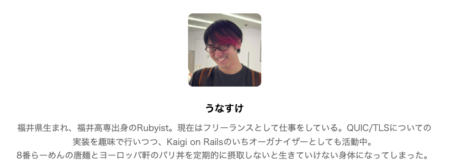{:relative_width='100' align='center'}

# いつもやってる自己紹介

* Name: うなすけ
* Work: フリーランス
* Kaigi on Rails organizer (from 2020〜)
* {::tag name='x-small'}GitHub <https://github.com/unasuke>{:/tag}
* {::tag name='x-small'}Fediverse <https://mstdn.unasuke.com/@unasuke>{:/tag}
* {::tag name='x-small'}X <https://x.com/yu_suke1994>{:/tag}
* {::tag name='x-small'}Website <https://unasuke.com>{:/tag}

{:relative_width='24' align='right' relative_margin_right='-8' relative_margin_top='25'}

# 来歴 : 生まれ
* 福井県敦賀市生まれ
    * <https://ja.wikipedia.org/wiki/敦賀市>
    * > 福井県の地方区分においては嶺南に含まれる。間投イントネーションがある嶺南方言が話されるとされる。

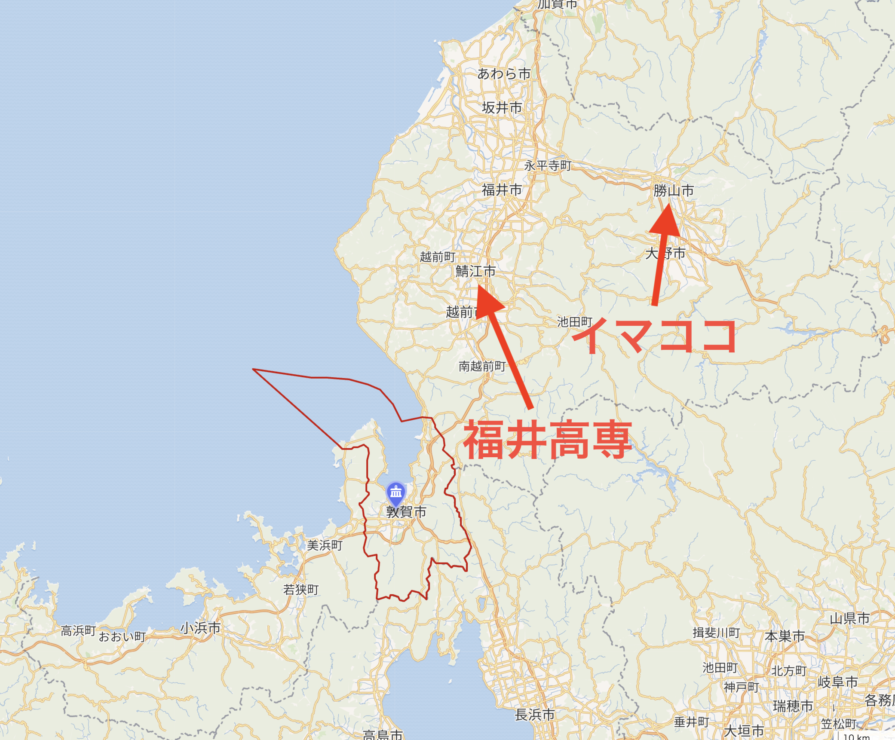{:relative_width='40'}

# 来歴 : 生まれ
{:relative_width='70'}

# 来歴 : 携帯電話が欲しい
* パソコン少年
    * 初めてのOSはWindows 98……だったか？
    * TOSHIBA Dynabook
* Windows VS フィーチャーフォン

# 来歴 : Windows Mobile
* スマートフォンとの出会い
    * <https://k-tai.watch.impress.co.jp/cda/article/review/43320.html>

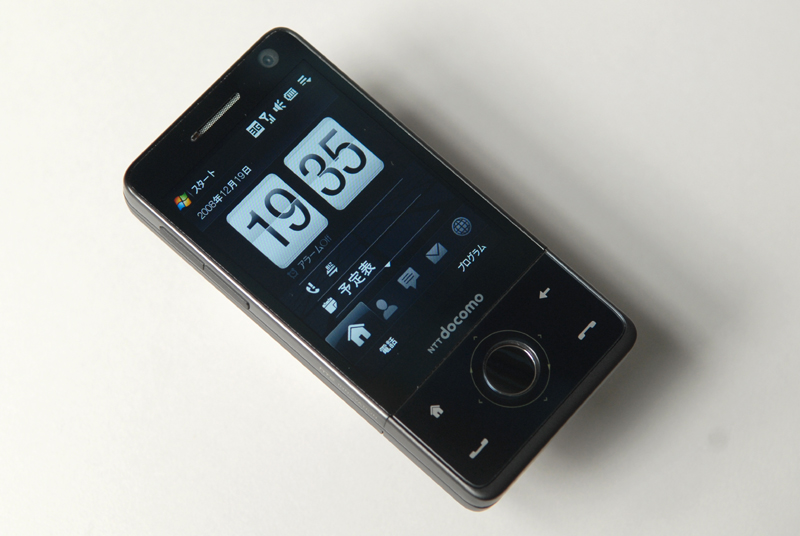{:relative_width='55'}

# 来歴 : 自分でアプリが作れるかも
* Windows Mobile
    * <https://relog.xii.jp/archives/2009/09/rewit_twitter_c.html>
    * <https://k-tai.watch.impress.co.jp/docs/news/352687.html>
* 正確にはフィーチャーフォンでも自作DoJaアプリを動かすこともできるらしい……？

# 来歴 : 福井高専入学
* 福井高専 電子情報工学科 入学
    * 先生方にはご迷惑をおかけしました……

{:relative_width='60'}

# 来歴 : 福井高専入学

{:relative_width='70'}

# 来歴 : 福井高専入学

{:relative_width='70'}

# 来歴 : 福井高専入学

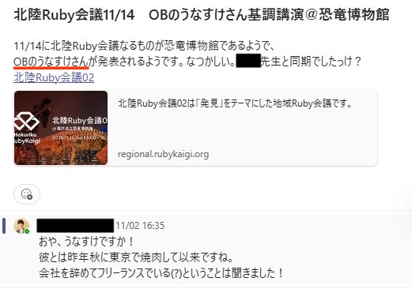{:relative_width='70'}


# 来歴 : 就活に苦戦する

{:relative_width='70'}


# 来歴 : spice life 入社
* 株式会社spice life
    * <https://blog.unasuke.com/2014/spice-life-gave-an-informal-decision-to-me/>
    * Railsの会社 (TMIX、STEERS等)
    * <https://blog.unasuke.com/2015/attended-rubykaigi-2015/>

# 来歴 : OOParts

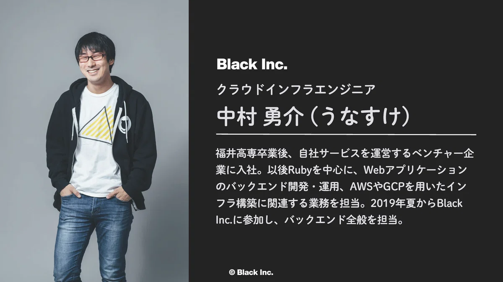{:relative_width='90'}

# 来歴 : クラウドゲーミング
* クラウドゲーミング
    * どこかのサーバーで動いているゲームの映像をユーザーに転送する
        * WebRTC一択
        * WebTransportという新技術 → QUICという新技術
    * ユーザーの操作をサーバー上のゲームに伝える
        * これが素早ければ素早いほどいい

# 来歴 : QUICを勉強し始める

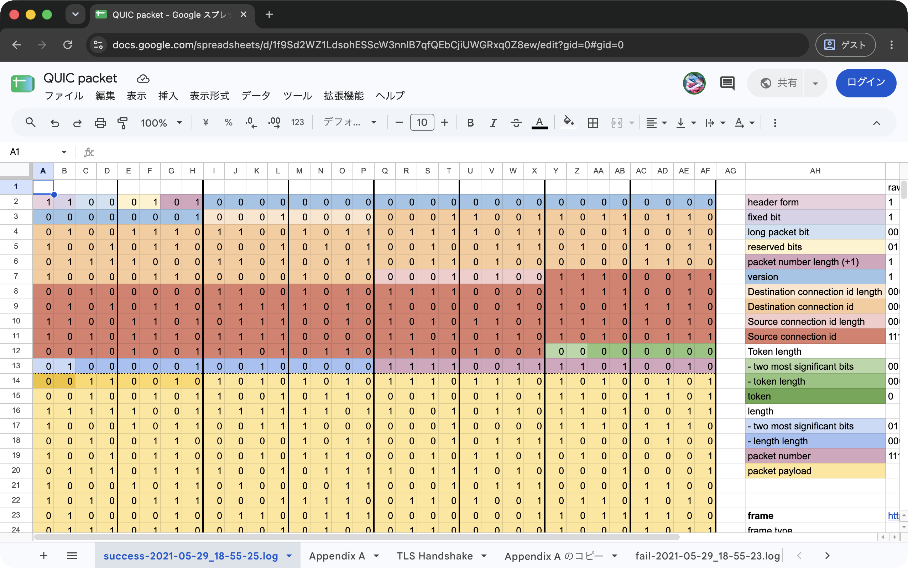{:relative_width='100'}

# 来歴 : QUICについて手を動かし始める
<https://blog.unasuke.com/2021/read-quic-initial-packet-by-ruby/>

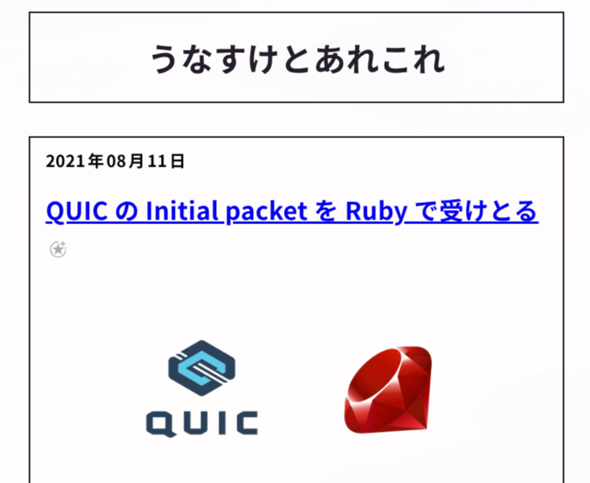{:relative_width='60'}

# 来歴 : QUICについて発表し始める
* RubyKaigi Takeout 2021
  * Ruby, Ractor, QUIC
* RubyKaigi 2022
  * Do Pure Ruby Dream of Encrypted Binary Protocol?
* RubyKaigi 2023
  * Ruby Implementation of QUIC: Progress and Challenges

# 来歴 : Kaigi on Railsの立ち上げメンバーになる

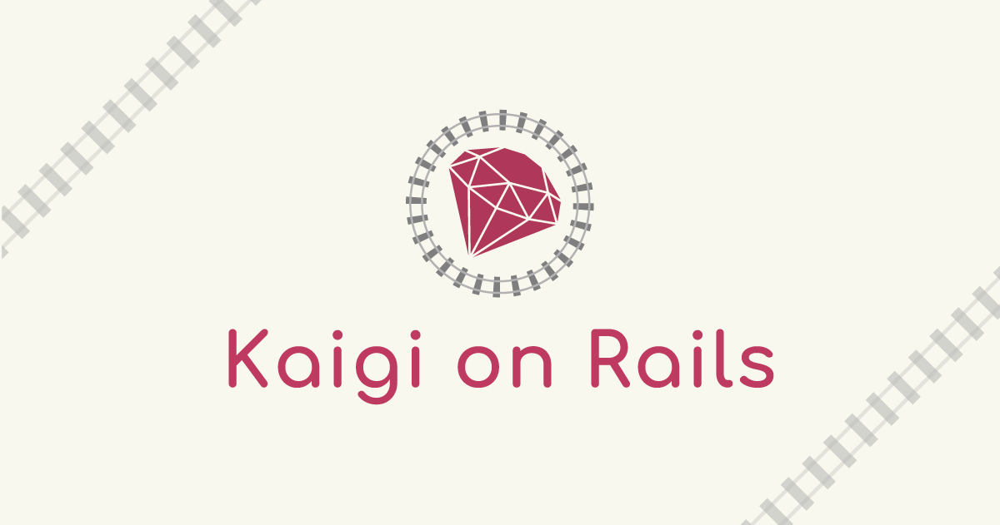{:relative_width='90'}

# 誰

{:relative_width='100' align='center'}


# 8番らーめん 「ラージャン、いいじゃん」

{:relative_width='75' align='center'}

# 発表概要

> "Dig" という単語には「掘る」というの意味の他にも「理解する」という意味があります。日本語でも「深堀る」という表現があるように、より深く内容について考えることを表わすのに "Dig" という言葉を使います。
> 
> このトークでは、私がここ数年取り組んでいるQUICというプロトコルについて、たぶんおそらく皆さんが気にしたことのない内容に焦点を当て、その内容について掘り下げていきます。
> 
> QUICは、現在ではインターネットの3割で使用されています。皆さんの普段のインターネット上での活動でも、おそらく使われています。そのような、いつの間にか使われているプロトコルがどのような事を考えて設計されたかについて、少しでも理解が進むような発表をしたいと考えています。

# インターネット

{:relative_width='35' align='center'}

岳陽舎 「インターネットの本」ドナルド・グラント画

# 日々のインターネット
* 用途
    * Googleで検索
    * Amazonでお買い物
    * LINEでメッセージや通話
* ツール
    * Google Chrome
    * Firefox
    * Edge

# インターネットでよく見るアレ

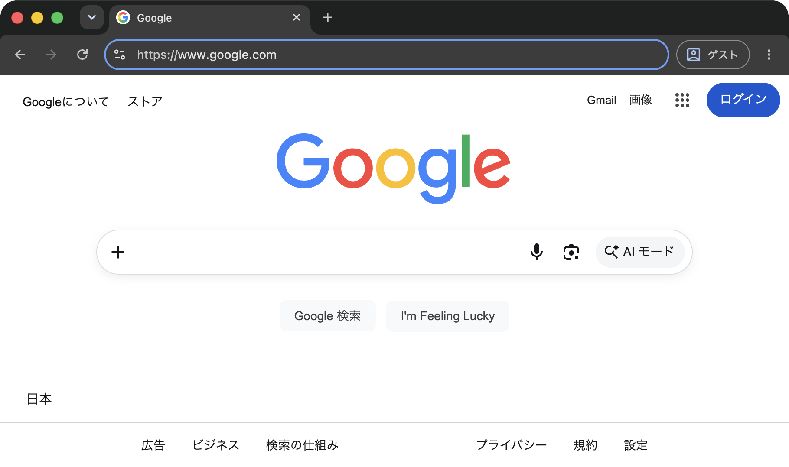{:relative_width='100'}


# インターネットでよく見るアレ
* "http"
  * "Hypertext Transfer Protocol"
* "s"
  * "Secure"

# TCPのイメージ？
{:relative_width='50'}

# UDPのイメージ？
{:relative_width='50'}

# QUICの公開
RFCという文章で仕様を公開することで誰でも実装できる

* 2013年 GoogleがQUICの実験を開始
* 2014年 GoogleがQUICの大規模な実験を開始
* 2021年 QUICのRFCが公開

年表は <https://www.chromium.org/quic/> より

# Cloudflare Radar

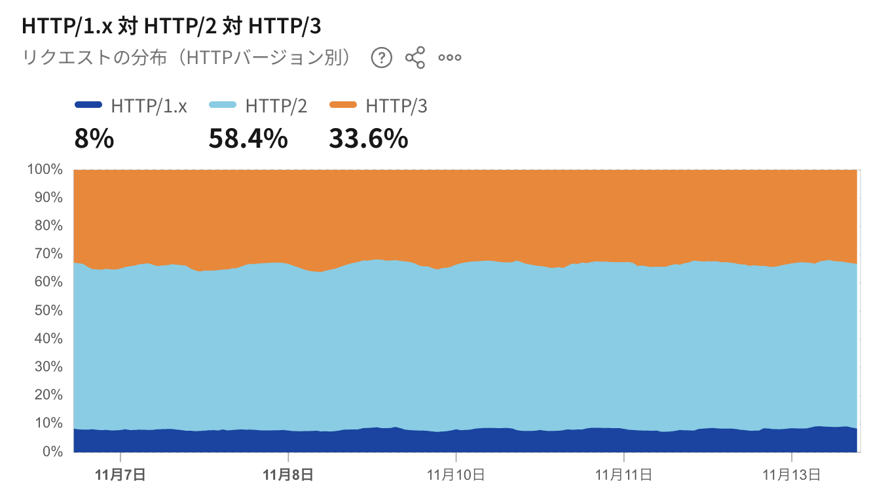{:relative_width='70'}

<https://radar.cloudflare.com/ja-jp/adoption-and-usage#http1x-vs-http2-vs-http3>

# Dig It!

{:relative_width='90'}

# "Design It!"

{:relative_width='30'}

<https://www.oreilly.co.jp/books/9784873118956/>

# "Design It!"

> モダンなアーキテクチャ設計のための実践的な手法が詰まった本書は、より良いプログラマー、技術リーダー、そしてソフトウェアアーキテクトになるために必携の一冊です。

<https://www.oreilly.co.jp/books/9784873118956/>

# "quic rfc"

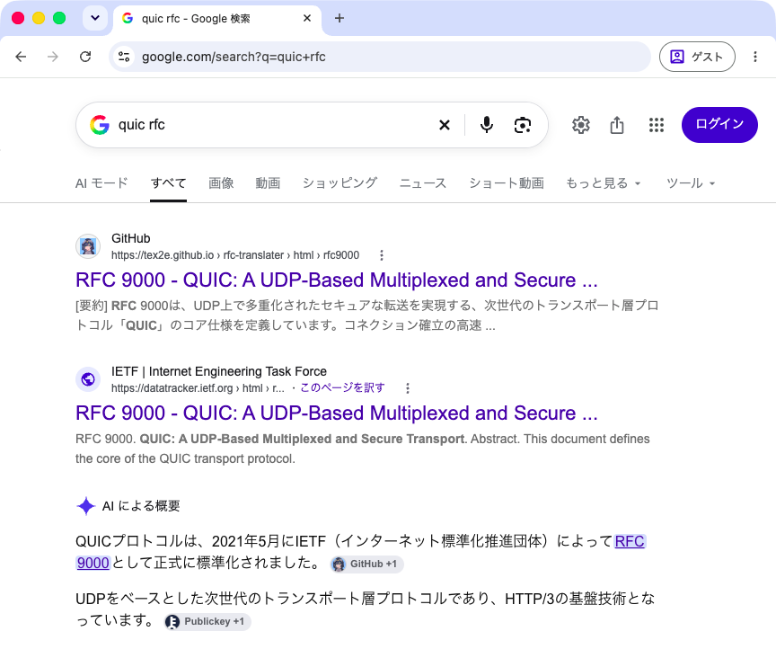{:relative_width='80'}

# QUICのRFCたち
* RFC 8999 *← 今日はコレ！*
    * Version-Independent Properties of QUIC
* RFC 9000
    * QUIC: A UDP-Based Multiplexed and Secure Transport
* RFC 9001
    * Using TLS to Secure QUIC
* RFC 9002
    * QUIC Loss Detection and Congestion Control

# パケット
{:relative_width='50'}

# パケットのヘッダ

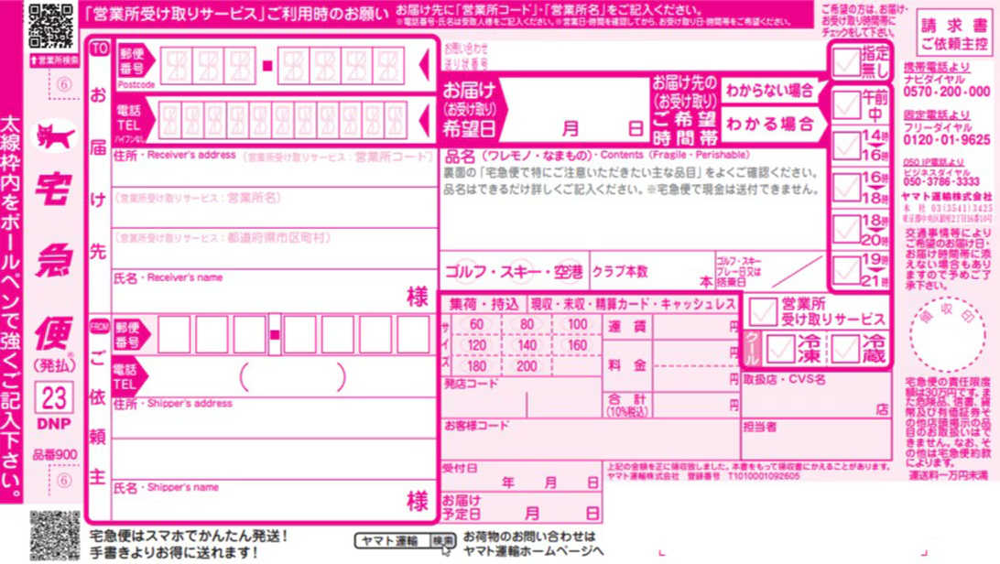{:relative_width='70'}

<https://www.kuronekoyamato.co.jp/ytc/customer/send/preparations/invoice/> より

# QUICのパケットのヘッダー
* Long header
* Short header

# QUIC Long header (RFC 8999)
```
Long Header Packet {
  Header Form (1) = 1,
  Version-Specific Bits (7),
  Version (32),
  Destination Connection ID Length (8),
  Destination Connection ID (0..2040),
  Source Connection ID Length (8),
  Source Connection ID (0..2040),
  Version-Specific Data (..),
}
```

# QUIC Long header (RFC 9000)
```
Long Header Packet {
  Header Form (1) = 1,
  Fixed Bit (1) = 1,
  Long Packet Type (2),
  Type-Specific Bits (4),
  Version (32),
  Destination Connection ID Length (8),
  Destination Connection ID (0..160),
  Source Connection ID Length (8),
  Source Connection ID (0..160),
  Type-Specific Payload (..),
}
```

# QUIC Short header (RFC 8999)
```
Short Header Packet {
  Header Form (1) = 0,
  Version-Specific Bits (7),
  Destination Connection ID (..),
  Version-Specific Data (..),
}
```

# QUIC Short header (RFC 9000)
```
1-RTT Packet {
  Header Form (1) = 0,
  Fixed Bit (1) = 1,
  Spin Bit (1),
  Reserved Bits (2),
  Key Phase (1),
  Packet Number Length (2),
  Destination Connection ID (0..160),
  Packet Number (8..32),
  Packet Payload (8..),
}
```

# QUIC Long header (RFC 8999) (again)
```
Long Header Packet {
  Header Form (1) = 1,
  Version-Specific Bits (7),
  Version (32), # QUIC v1では 0x00000001, v2では 0x6b3343cf
  Destination Connection ID Length (8),
  Destination Connection ID (0..2040),
  Source Connection ID Length (8),
  Source Connection ID (0..2040),
  Version-Specific Data (..),
}
```

# QUIC Version Negotiation Packet
```
Version Negotiation Packet {
  Header Form (1) = 1,
  Unused (7),
  Version (32) = 0,
  Destination Connection ID Length (8),
  Destination Connection ID (0..2040),
  Source Connection ID Length (8),
  Source Connection ID (0..2040),
  Supported Version (32) ...,
}
```

RFC 8999 だいたいこのくらいまで

# QUIC RFCs words count

| RFC | 単語数 `wc -w rfcXXXX.md` |
| --- | --- |
| RFC 8999 | 2,273 |
| RFC 9000 | 55,630 |
| RFC 9001 | 16,485 |
| RFC 9002 | 10,897 |

<https://github.com/quicwg/base-drafts> より

# RFC 8999 Appendix A
* Appendix A. Incorrect Assumptions 
    * 付録 A. 誤った前提
    * > 本節では、QUIC バージョン1の知識に基づいて QUIC についてなされる可能性のある誤った仮定の見本を列挙する。これらの記述のいくつかは、QUIC バージョン1にすら当てはまらない。これは網羅的なリストではなく、例示的なものに過ぎない。

## properties
background-image
:  img/hokurikurk02-bg-upper-right-with-qr.png

# HTTP protocol stacks

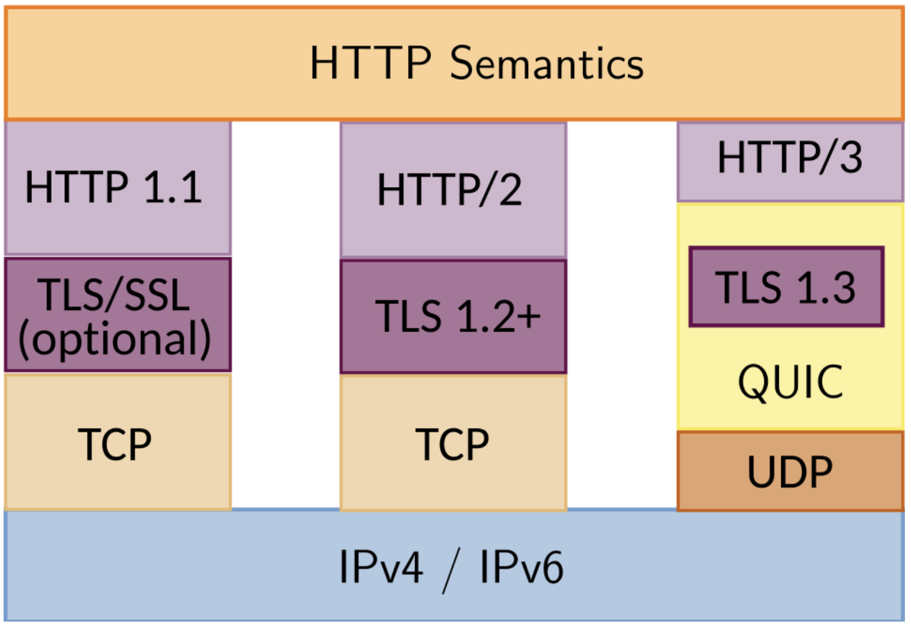{:relative_width='60'}

<https://en.wikipedia.org/wiki/QUIC> より

# QUICの暗号化層がTLS 1.3という前提(誤)
* "QUIC uses TLS, and some TLS messages are visible on the wire."
    * 「 QUICはTLSを使用しており、一部のTLSメッセージはネットワーク上で確認できます。」
* QUIC-MLS: Making a Space Security Draft Standard Resilient for Disconnected Environments
    * <https://eprint.iacr.org/2025/2063>


# QUICのパケット番号が1ずつ増える(誤)
* "QUIC packet numbers increase by one for every packet sent."
    * 「QUICのパケット番号は、パケットを送信するごとに1ずつ増加します。」
* Multipath QUICでは経路ごとにパケット番号が採番される
    * RFC 10069: Managing Multiple Paths for a QUIC Connection
* 送信側は送ったパケット番号を知っている
    * 受信側は受け取ったパケット番号の最大値と範囲を送る
    * Optimistic ACK攻撃


# QUIC Long header (RFC 9000) (again)
```
Long Header Packet {
  Header Form (1) = 1,
  Fixed Bit (1) = 1,
  Long Packet Type (2),
  Type-Specific Bits (4),
  Version (32),
  Destination Connection ID Length (8),
  Destination Connection ID (0..160),
  Source Connection ID Length (8),
  Source Connection ID (0..160),
  Type-Specific Payload (..),
}
```

# QUIC Short header (RFC 9000) (again)
```
1-RTT Packet {
  Header Form (1) = 0,
  Fixed Bit (1) = 1,
  Spin Bit (1),
  Reserved Bits (2),
  Key Phase (1),
  Packet Number Length (2),
  Destination Connection ID (0..160),
  Packet Number (8..32),
  Packet Payload (8..),
}
```

# Fixed Bit
* "QUIC packets always have the second bit of the first byte (0x40) set."
    * 「QUICパケットでは、常に第1バイト（0x40）の第2ビットがセットされています。」
* RFC 9000では "Fixed Bit (1) = 1"
    * "Packets containing a zero value for this bit are not valid packets in this version and MUST be discarded."

# Fixed Bit
* RFC 8999では "Version-Specific Bits" の一部
    * RFC 9287: Greasing the QUIC Bit
        * > Endpoints that receive the grease_quic_bit transport parameter from a peer SHOULD set the QUIC Bit to an unpredictable value unless another extension assigns specific meaning to the value of the bit.


# Greasing?

{:relative_width='50'}


# TLS 1.2 → TLS 1.3

```
struct {
    ProtocolVersion legacy_version = 0x0303;    /* TLS v1.2 */
    Random random;
    opaque legacy_session_id<0..32>;
    CipherSuite cipher_suites<2..2^16-2>;
    opaque legacy_compression_methods<1..2^8-1>;
    Extension extensions<7..2^16-1>;
} ClientHello;
```

# TLS 1.2 → TLS 1.3

> 従来のTLSバージョンでは、このフィールドはバージョンネゴシエーションに使用され、クライアントがサポートする最高バージョン番号を表していました。これまでの経験から、多くのサーバーがバージョンネゴシエーションを適切に実装しておらず、その結果、サーバーが本来であれば許容できるはずのClientHelloであっても、サポートしているバージョンより高いバージョン番号が含まれている場合にこれを拒否するという「バージョン不寛容」が生じていることが分かっています。

<https://www.rfc-editor.org/info/rfc9846/#name-client-hello>

# ossification (骨化、硬直化)

> 「硬直化(ossification)」とは、インターネット上のアプリケーションやネットワーク装置などによってプロトコルの新しいバージョンや新しい拡張仕様の通信が正しく中継されず阻害されることです。

<https://asnokaze.hatenablog.com/entry/2020/07/07/231357> より

{:relative_width='40'}


# QUIC v2 (RFC 9369)
> QUIC version 2 is meant to mitigate ossification concerns and exercise the version negotiation mechanisms. 
> (QUICバージョン2は、硬直化への懸念を軽減し、バージョンネゴシエーション機構を検証することを目的としています。)

<https://www.rfc-editor.org/info/rfc9369/> より

# HTTP protocol stacks (again)

{:relative_width='60'}

<https://en.wikipedia.org/wiki/QUIC> より

# IPアドレスの例
* IPv4
    * `192.0.2.1`
    * `198.51.100.42`
* IPv6
    * `2001:db8::1`
    * `2001:db8:cafe::53`

# ドメインとIPアドレスの対応
* google.com
    * `172.217.221.139` とか
* yahoo.co.jp
    * `124.83.187.252` とか
* amazon.co.jp
    * `18.246.99.104` とは

※ 発表時点

# DNSの通信内容は暗号化されていない！

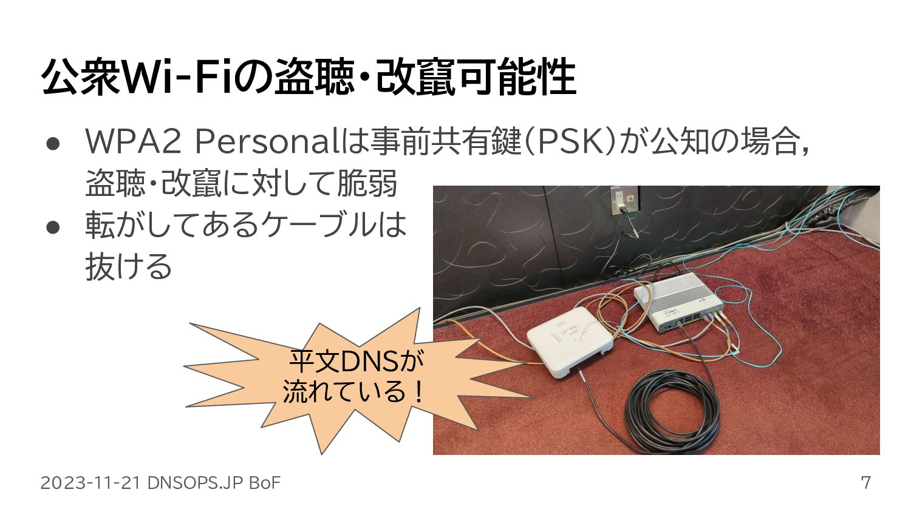{:relative_width='75'}

<https://speakerdeck.com/hanazuki/secure-dns-resolver-at-rubykaigi-2023> より

# DNSの通信を暗号化したい
* DNS over TLS (RFC 7858)
    * TLSで暗号化する
* DNS over HTTPS (RFC 8484)
    * HTTPSで暗号化する
* DNS over QUIC (RFC 9250)
    * QUICで暗号化する

# 理想形(たぶんそうなることは少ない)
`https://blog.unasuke.com/` に行くために……

1. DNS over QUICでIPアドレスの解決を行う
    * ここが多分あんまりそうならない
2. HTTP/3 (QUIC)で `https://blog.unasuke.com/index.html` を取得する

# 自分のここ数年の取り組み
* RFCだけあっても実装がないと通信ができない
    * そもそも実装がないとRFCとして公開されない
* QUICの実装
    * Google発 (Chromeとか)
    * Apple (iPhoneとか)
    * Microsoft (Windowsとか)

# 自分のここ数年の取り組み
* QUICの実装
    * Google発
    * Apple (iPhoneとか)
    * Microsoft (Windowsとか)
    * 組み込んで使えるライブラリ
        * ngtcp2, nghttp3, quiche...

# 自分のここ数年の取り組み
* quic gem, http3, gem
    * それぞれ ngtcp2, nghttp3 をbindingする
    * 広く使われており実績のあるC実装
* raiha gem
    * Pure RubyによるQUIC (HTTP/3)実装
    * Ruby言語自体へのフィードバック、移植容易性
    * 自分の学習のため
* protocol-quic gem, protocol-http3 gem
    * それぞれ ngtcp2, nghttp3 をbindingするSamuel氏のプロジェクト

# 自分のここ最近の取り組み
* <https://github.com/unasuke/dohyo>
    * protocol-quicを採用しているDNS権威サーバー
    * `ns1.unasuke.com` で動いています
* quic gem, http3, gem と raiha gem
    * <https://blog.unasuke.com> を配信しています

# Why?

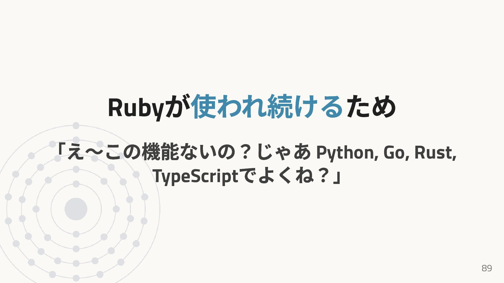{:relative_width='75'}

<https://speakerdeck.com/sylph01/ren-ming-wojiu-uji-shu-tositenoend-to-endan-hao-hua-tomessaging-layer-security> より

# プロトコル実装されがち言語
* C, C++
    * 色々な言語から利用できる、高性能
* Rust
    * より安全性が高い、高性能
* Python
    * 実装する人が多い、そこそこ性能


# 有言実行

{:relative_width='90'}

# まとめ
* QUICはむずかしい！
    * 深掘りするといろいろな歴史が見えてくる
* QUICをRubyの世界にもってくる活動をしています
    * quic gem, http3, gem と raiha gem
* `dig +tls @ns1.unasuke.com blog.unasuke.com a`
    * Dig It!
